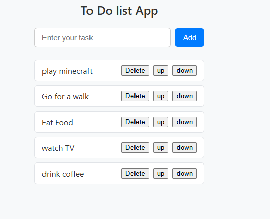

# To Do list App

A clean and minimal task management application built using React and Vite.

## Preview

## Features

- Add new daily tasks quickly
- Delete completed or unwanted tasks
- Reorder tasks up and down with instant state updates
- Responsive and clean minimal UI

## Tech Stack

- React
- JavaScript
- CSS3
- Vite

## Getting Started

1. Navigate to the project directory:
   cd To_Do-List/to_do_list

2. Install dependencies:
   npm install

3. Run the development server:
   npm run dev

Open your browser at the local link shown in your terminal.
